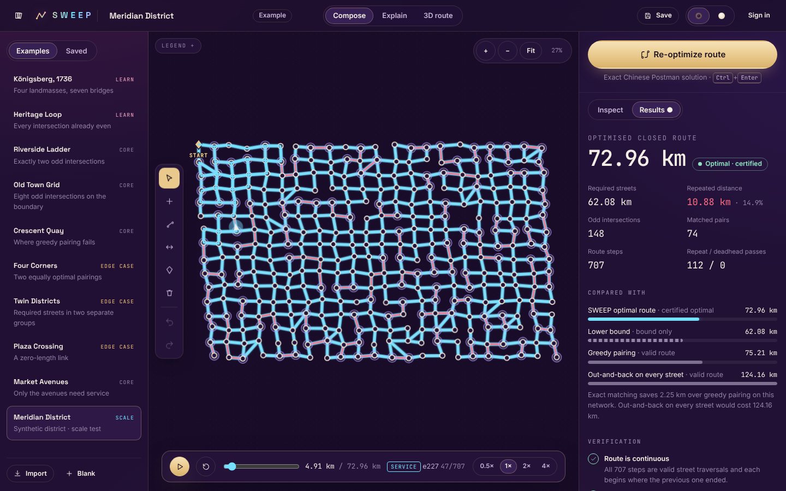
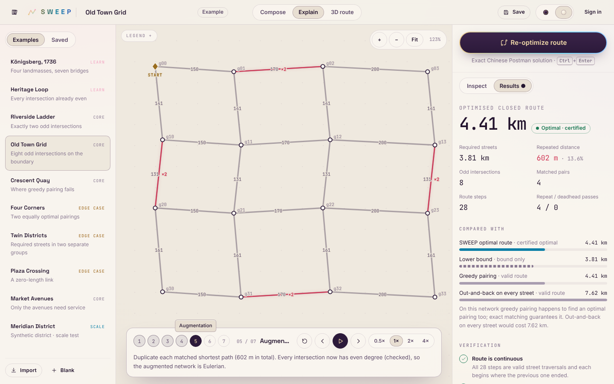
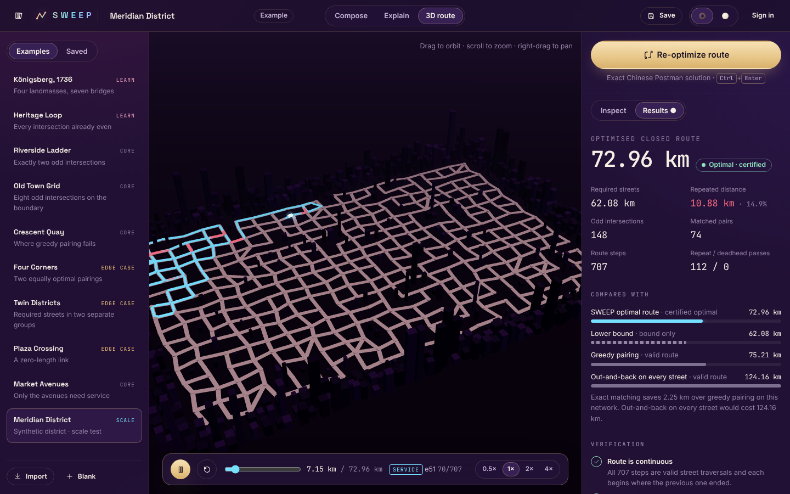
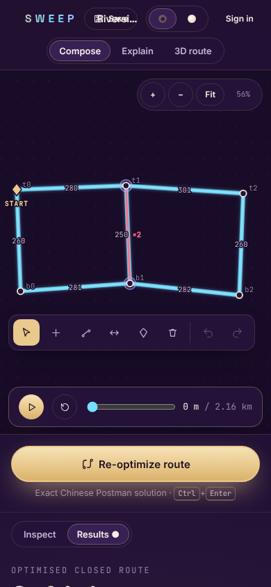

# SWEEP

**Every street. One intelligent route.**
*Every street has a story. Every route has a proof.*

SWEEP is an urban route-intelligence platform. You build or import a street network and mark the streets that need service. SWEEP computes the **exact shortest closed route** that covers them all (the undirected Chinese Postman Problem), shows why it is optimal, and lets you drive it in 2D and 3D.


| Workspace (Velvet) | Explain mode (Porcelain) |
|---|---|
|  |  |

| 3D route | Porcelain landing | Phone |
|---|---|---|
|  |  |  |

## What it does

* **Exact optimisation.**
  * Odd-degree vertices and Dijkstra shortest paths.
  * Edmonds' blossom minimum-weight perfect matching, with an **LP-duality optimality certificate** on every run and an exhaustive DP cross-check on small cases.
  * Path duplication and a Hierholzer Euler circuit.
  * Optional streets can be used as unserviced shortcuts (deadheading).
* **Honest results.**
  * Total and repeated distance.
  * Real baselines: lower bound, greedy pairing, out-and-back.
  * Eight independent verification checks.
  * Assumptions, plus a reproducibility hash.
* **Visible mathematics.** A seven-step explanation generated from the actual computation: degrees, odd intersections, auxiliary graph, matching, augmentation, Euler circuit, verification.
* **A real editor.**
  * Add, move, connect, re-weight and delete streets.
  * Required/optional toggles and a start marker.
  * Undo and redo, plus a keyboard-accessible streets table.
  * Ten bundled scenarios, including Königsberg 1736, a greedy trap, ties, a disconnected district, a zero-length link and a 351-intersection district.
  * GeoJSON import.
* **3D.** A procedural city generated from the network itself, with the vehicle following the ordered route in sync with playback.
* **Accounts and persistence.**
  * scrypt-hashed passwords, hashed session tokens, CSRF protection and rate limits.
  * Owner-scoped scenarios and stored runs you can reopen.
  * JSON and CSV exports and a printable report.
* **Two themes.** *Velvet*, a royal aubergine night with champagne-gold hairlines, and *Porcelain*, a cream architectural model. Also a cherry-blossom cursor field with click-to-bloom, and full reduced-motion support.

## Quick start

```bash
corepack enable
pnpm install
pnpm build
pnpm start          # → http://localhost:8787 (API + web app)
```

Development: `pnpm dev`. The web app runs on :5173 and the API on :8787.

The app works **without an account** and without any external service; the bundled examples load instantly. A static, serverless build (`pnpm build:static`) runs the identical engine in a Web Worker.

## Tests

```bash
pnpm verify    # typecheck → unit/property/integration → Python oracle → build → Playwright e2e + axe
```

Latest recorded run: **all green**.

* Engine: 36 tests.
* Server: 16 tests.
* Web: 5 tests.
* Oracle: 660 graphs, agreeing with networkx and brute force.
* Browser: 32 end-to-end and accessibility tests on desktop and mobile.

Details and measured benchmarks are in [TEST_PLAN.md](TEST_PLAN.md).

## Documentation

| Document | Contents |
|---|---|
| [PROJECT_BRIEF.md](PROJECT_BRIEF.md) | What and why |
| [PRD.md](PRD.md) | Requirements and their status |
| [ARCHITECTURE.md](ARCHITECTURE.md) | Components, API, data model |
| [MATHEMATICAL_SPEC.md](MATHEMATICAL_SPEC.md) | Model semantics, algorithm, proof of optimality, complexity, certificates |
| [DESIGN_SYSTEM.md](DESIGN_SYSTEM.md) | Themes, tokens, typography, motion, signature effects |
| [SECURITY.md](SECURITY.md) | Threat model and controls |
| [TEST_PLAN.md](TEST_PLAN.md) | Test suites, latest results, performance |
| [DEPLOYMENT.md](DEPLOYMENT.md) | Running, configuration, Docker, Pages, what is and is not verified |
| [TASKS.md](TASKS.md) | Milestones and remaining work |

## Limitations

* Streets are undirected only.
* A single closed route; no fleets, capacities, time windows or turn costs.
* Required streets must be connected. When they are not, SWEEP explains the NP-hard case and suggests connectors.
* Exact matching is supported up to 600 odd intersections in interactive use.
* The bundled districts are synthetic.
* There is no password reset, because no email service is configured.
* There is no public deployment yet; see [DEPLOYMENT.md](DEPLOYMENT.md).
