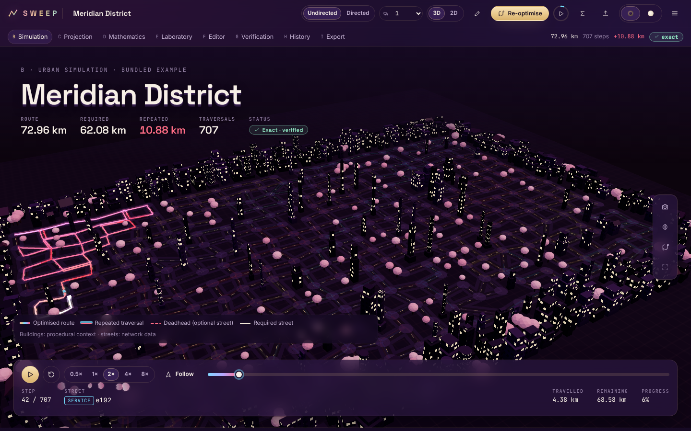
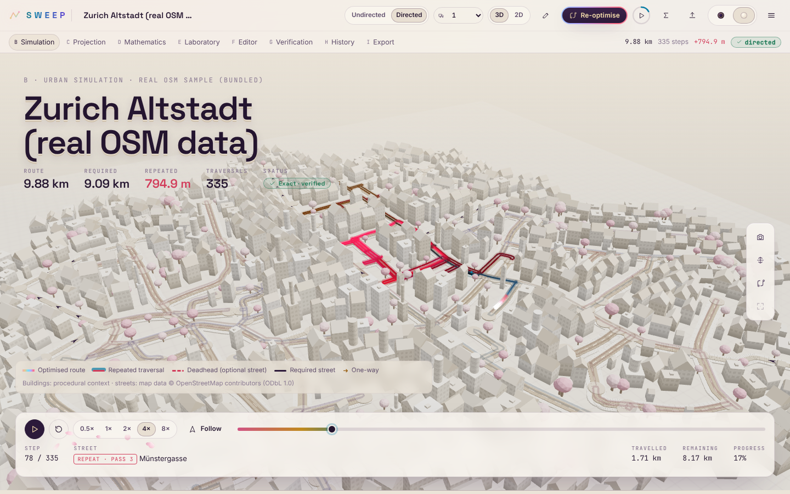
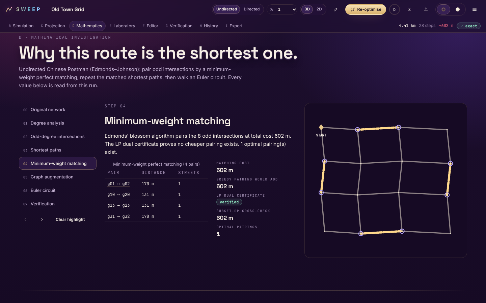
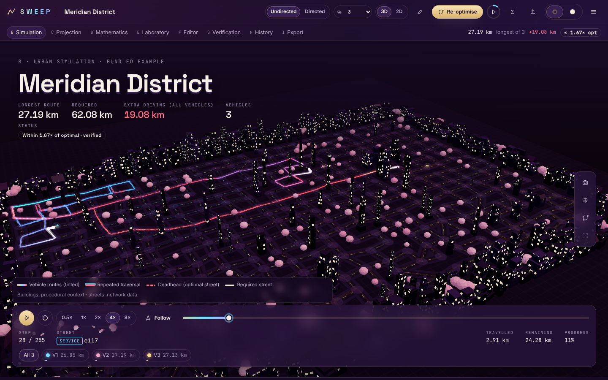

# SWEEP

**Every street. One intelligent route.**
*Every street has a story. Every route has a proof.*

SWEEP is an urban route-intelligence platform. You build, import or acquire a street network and mark the streets that need service. SWEEP then computes the **shortest closed route that covers them all**, proves that it is optimal, and drives it through a 3D city:

* undirected networks: the Chinese Postman Problem;
* one-way and mixed networks: the directed and mixed postman problems;
* several vehicles: a split route with a stated guarantee.

No account is needed for any of it.



| Real OSM data, directed (Porcelain) | Mathematical investigation |
|---|---|
|  |  |

| Route-performance laboratory | Fleet of three vehicles | Phone |
|---|---|---|
|  |  |  |

## What it does

* **Exact undirected optimisation.**
  * Odd-degree vertices and Dijkstra shortest paths.
  * Edmonds' blossom minimum-weight perfect matching, with an LP-duality optimality certificate on every run.
  * Path duplication and a Hierholzer Euler circuit.
  * Optional streets can be used as unserviced shortcuts (deadheading).
* **Exact directed and mixed optimisation** (a separate module; the undirected algorithm is never used for a one-way network).
  * Minimum-cost flow that balances in- and out-degrees, certified by LP duality.
  * Directed Hierholzer circuit.
  * Two service rules for two-way streets: *each direction* (both kerbs) or *either direction*. The mixed rule is solved exactly by enumerating orientations, up to 12 two-way required streets.
  * Infeasible one-way layouts are diagnosed street by street, with a one-click fix.
* **Multiple vehicles.**
  * Min–max split of the certified route (Frederickson–Hecht–Kim), with an exact split DP and the lower bound.
  * The guarantee is stated honestly: ≤ (2 − 1/k) × optimum for undirected fleets, exact for the *total distance* objective, and heuristic with no ratio claim for directed fleets.
* **Real map data.**
  * Live acquisition of an OpenStreetMap area through the Overpass API, with provider fallback, a 7-day cache, provenance and classified errors.
  * Place search through Nominatim, at most 1 request per second.
  * GeoJSON import.
  * A bundled real extract of Zurich's Altstadt (ODbL, © OpenStreetMap contributors).
* **The workspace** is one long, scrollable environment:
  * **A** command header;
  * **B** a dominant 3D district simulation:
    * buildings aligned to the real streets;
    * a spectral route shader driven by true route distance;
    * vehicles that follow the computed order;
    * orbit, focus and follow cameras;
  * **C** a live 2D projection;
  * **D** a step-by-step mathematical investigation generated from the actual computation and highlighted in the city;
  * **E** a laboratory comparing the exact route with real baselines, the undirected relaxation and fleet sizes;
  * **F** a network editor: add, move, connect, weights, required, one-way, delete, undo and redo, auto-solve;
  * **G** verification and the technical report;
  * **H** local scenario and experiment history;
  * **I** exports (JSON, route/streets/fleet CSV, GeoJSON, printable report).
* **Honest results.**
  * Independent verification checks on every run.
  * Real baselines (lower bound, greedy pairing or balancing, out-and-back or return-after-each).
  * Assumptions and a reproducibility hash.
  * "Clear local data" removes everything SWEEP stored in the browser, after confirmation.
* **Two themes.** *Velvet*, a royal aubergine night with champagne-gold hairlines, and *Porcelain*, a cream architectural model. Both come with a cherry-blossom cursor field: lighter over the editor, never in the way of controls, and off under reduced motion.
* **Optional accounts.** scrypt-hashed passwords, hashed session tokens, CSRF protection and rate limits, plus owner-scoped scenarios and stored runs. Nothing requires signing in.

## Quick start

```bash
corepack enable
pnpm install
pnpm build
pnpm start          # → http://localhost:8787 (API + web app)
```

* **Development:** `pnpm dev` runs the web app on :5173 and the API on :8787.
* **Docker:** `docker compose up --build`. See [DEPLOYMENT.md](DEPLOYMENT.md) for the image, the health check, persistence and the `tests` profile.
* **Static build:** `pnpm build:static` produces a serverless build that runs the identical engine in a Web Worker.

The workspace opens straight into a solved district. Bundled examples work offline. Live map acquisition needs outbound access to a public Overpass instance; when none is reachable, SWEEP says which providers failed and why, and points to GeoJSON import or the bundled Zurich sample.

## Tests

```bash
pnpm verify    # typecheck → lint → unit/property/integration → Python oracle → build → Playwright e2e + axe
```

Latest recorded run: **all green**, locally and on GitHub Actions (the `verify` job, plus a `docker` job that builds the image, checks health, smoke-tests and restarts).

| Suite | Count |
|---|---|
| Engine | 96 tests |
| Server | 38 tests |
| Web | 7 tests |
| Oracle, undirected | 661 graphs, checked against networkx and brute force |
| Oracle, directed and mixed | 1,401 graphs, checked against networkx min-cost flow and a state-space search |
| Browser | 37 end-to-end and accessibility tests, desktop and mobile, both themes |

Details are in [TEST_PLAN.md](TEST_PLAN.md).

## Documentation

| Document | Contents |
|---|---|
| [PROJECT_BRIEF.md](PROJECT_BRIEF.md) | What and why |
| [PRD.md](PRD.md) | Requirements and their status |
| [ARCHITECTURE.md](ARCHITECTURE.md) | Components, API, data model, frontend structure |
| [MATHEMATICAL_SPEC.md](MATHEMATICAL_SPEC.md) | Model semantics, algorithms, proofs, guarantees, complexity |
| [DESIGN_SYSTEM.md](DESIGN_SYSTEM.md) | Themes, tokens, typography, spectral shader, blossom field |
| [SECURITY.md](SECURITY.md) | Threat model and controls, including map acquisition |
| [TEST_PLAN.md](TEST_PLAN.md) | Test suites, latest results, performance |
| [DEPLOYMENT.md](DEPLOYMENT.md) | Running, configuration, Docker, CI, what is and is not verified |
| [TASKS.md](TASKS.md) | Milestones and remaining work |

## Map data attribution

Street data acquired or bundled from OpenStreetMap is © OpenStreetMap contributors, available under the [Open Database License](https://www.openstreetmap.org/copyright). SWEEP shows this attribution wherever such data appears: the simulation, reports and exports.

## Limitations

* **Mixed networks.** The *either direction* rule is exact only up to 12 required two-way streets; larger instances are refused with an explanation rather than approximated.
* **Disconnected required streets.** These make the rural postman problem NP-hard, so SWEEP refuses them, explains why, and suggests connectors.
* **Fleets.** Fleet plans split one certified route and come with the stated bound; they are not proven min–max optima. There are no capacities, time windows or turn costs.
* **Size.** Exact undirected matching is limited to 600 odd intersections in interactive use, and a map acquisition to 4 km².
* **3D context.** Buildings in the 3D city are procedural context generated from the streets, not real footprints; the legend says so.
* **Accounts.** There is no password reset, because no email service is configured.
* **Hosting.** There is no public deployment yet; see [DEPLOYMENT.md](DEPLOYMENT.md).
